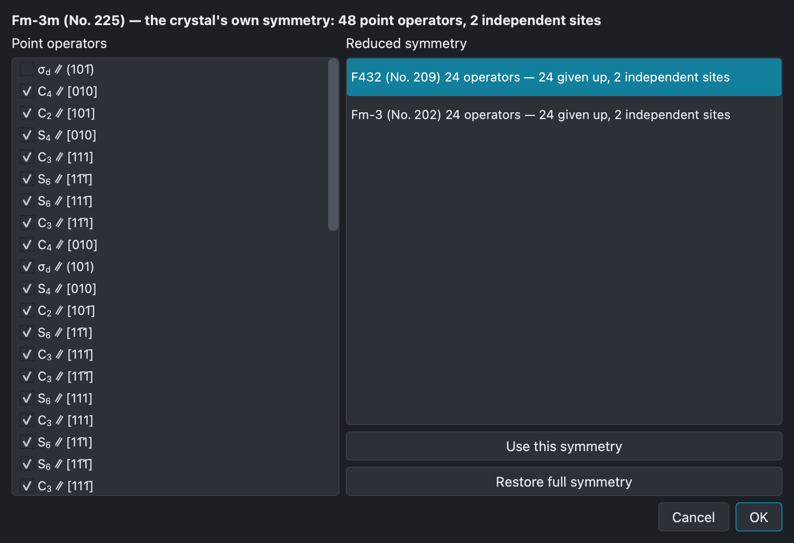

# Symmetry

## The Info panel

The symmetry reported depends on the periodicity of the structure:

| Structure | Symmetry |
| --- | --- |
| crystal (3D) | space group |
| slab (2D) | layer group |
| polymer (1D) | rod group, see below |
| molecule (0D) | point group |

The panel also reports the point group, the lattice parameters, the cell volume
or area, the density and the formula. All of them are recomputed when the
structure is edited.

A polymer's symmetry is a rod group, reported with CRYSTAL's numbering: the 99
of Appendix A.3 of the CRYSTAL manual, each a subset of a space group, with the
chain along *x*. The symmetry library the program uses (spglib) has no rod
groups, so they are found here: the axis of the chain is where every one of its
operations leaves it, the orientations tried about it are those of its mirror
planes and twofold axes, and the largest group the chain satisfies is taken. A
deck written for a polymer is in that group, with its asymmetric unit, once the
group has been shown to rebuild the chain; otherwise in rod group 1, with every
atom listed, which is always valid. Reducing the symmetry of a polymer is not
supported yet; see [Not supported yet](index.md#not-supported-yet).

### Which cell is described

A space group can be written in several settings, and a crystal computed in a
non-standard one has lattice parameters its standard description does not
share. The **Cell** box at the top of the Info panel chooses between the two:

| Cell | What the panel reports |
| --- | --- |
| **As in the file** | the cell drawn in the 3D view, with the space group named in that cell's own setting (P2₁/n) |
| **Standard setting** | the conventional standard cell, with the group's standard symbol (P2₁/c) |

The choice is remembered between sessions, and the
[CRYSTAL input builder](inputs.md#the-geometry-block) starts on it. It applies
to crystals only: a slab is always described by its layer group and in-plane
cell.

## Point symmetry analysis

**Cell → Point symmetry analysis** lists the symmetry elements of the
structure: rotation axes, mirror planes and inversion centres. They are also
drawn in the view.

The operators are named in the Schoenflies notation used in chemistry:
C2 to C6 for rotation axes, S4 and
S6 for rotoreflection axes, σ for a mirror plane and i for a centre
of inversion. Where the group allows it the mirrors are distinguished as
σh, σv and σd.

In a crystal each element carries its orientation in lattice terms: an axis by
the direction it runs along, as in C4 ∥ [001], and a mirror by the
plane it lies in, as in σ ∥ (110). In a molecule, which has no lattice, both
are given as Cartesian directions.

The group itself is reported in its own convention: Hermann–Mauguin for a space
or layer group, Schoenflies for a molecular point group.

## Reducing the symmetry

A calculation is sometimes run in a symmetry lower than that of the ideal
structure: to allow a distortion to relax, to remove a degeneracy, or to
converge a particular magnetic state.

The **Reduce symmetry…** button of the point-symmetry panel removes
point-symmetry operators. The subgroups generated by the operators that remain
are then listed:

:::{div} crystal-shot

:::

Subgroups that cannot be written in a CRYSTAL deck are listed in grey rather
than omitted. Each candidate is verified by reconstruction: the operators are
multiplied out and the structure is rebuilt from them, so that a subgroup is
offered only if it regenerates the crystal.

**No symmetry (P1)** keeps the identity alone, so that every atom of the cell is
independent. It is always available, also where removing operators one at a
time cannot reach it: below F222 the subgroups of rock salt are all written in
another cell, and are listed in grey.

The reduction applies to the structure itself. The Info panel reports it under
**Treated as**, and the decks written afterwards use it.

## Slabs

The symmetry of a slab is a layer group, one of the 80. The direction normal to
the slab is not a lattice vector, and treating the structure as
three-dimensional would count the vacuum as one.

The layer group is determined with the aperiodic direction placed along **c**,
as CRYSTAL expects, with the layer centred in the cell, and is verified by
rebuilding the slab from it before use. The deck is then written in that layer
group, with only the asymmetric unit listed; see [CRYSTAL input builder](inputs.md).

Symmetry reduction is not available for slabs, and the dialog reports the
reason: a layer group is not a space group.
